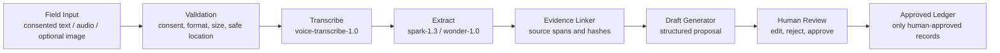

# Architecture: Narrow MVP to Global Direction

## Evidence-linked workflow

Image input is optional. An image may be attached as an evidence reference using a content hash; image interpretation is out of scope until separately specified and approved. The pipeline must retain provenance so reviewers can trace each extracted statement to source material. If evidence is missing or ambiguous, the system records missing information and asks a follow-up instead of filling gaps.

## MVP boundary

The MVP should prove one narrow, supervised workflow with synthetic public-demo data: submit consented sample input, transcribe when audio is used, extract a small set of fields, link claims to evidence, produce a draft, and let a human approve or reject it. It should not autonomously publish, allocate resources, contact participants, or treat model confidence as truth. Location should be generalized or withheld unless a safe precision is explicitly selected.

## Global direction

The architecture should permit additional languages, local terminology, policy settings, retention rules, and human review roles without assuming that a Bangladesh workflow applies everywhere. The aspiration of 100+ languages is a design target, not an MVP promise or verified model capability. Language coverage, transcription quality, extraction quality, and accessibility require evaluation per language and community before being claimed.

## Failure behavior

Reject malformed or oversized inputs; preserve a safe error state; identify low-confidence or unlinked claims for review; never turn a failed transcription into an invented transcript; and keep model/service failures visible to the coordinator. No record reaches the approved ledger until an authorized human approves it.