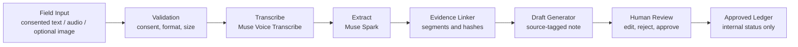

# aLive Bangladesh Coordinator Agent - Evidence-Linked - 1st Proof of meUus Human Operating System - Meta Global AI Hackathon 2026 Startup Track

Bismillah.

## Vision

Anyone can continue from anywhere; the weakest soul ever can continue through meUus. This is a narrow aLive Bangladesh proof for **Build for Your World**: a coordinator turns consented field input into an evidence-linked draft that a human can review.

The project is an MVP, not the complete meUus ecosystem. See [HACKATHON_NEW.md](HACKATHON_NEW.md) for the pre-existing/new-work boundary and [the bridge note](docs/meUus_to_aLive_BRIDGE.md) for the conceptual mapping.

## Live URLs

- Primary aLive flow: [Bangla new field visit](https://alive-bangladesh-coordinator-meta-a.vercel.app/bn/new)
- Human OS: [`/welcome`](https://alive-bangladesh-coordinator-meta-a.vercel.app/welcome), [`/home`](https://alive-bangladesh-coordinator-meta-a.vercel.app/home), [`/dashboard`](https://alive-bangladesh-coordinator-meta-a.vercel.app/dashboard), [`/pillars/alive`](https://alive-bangladesh-coordinator-meta-a.vercel.app/pillars/alive)
- Public GitHub: [mdmahadyhasanruju-byte/alive-bangladesh-coordinator-meta-ai](https://github.com/mdmahadyhasanruju-byte/alive-bangladesh-coordinator-meta-ai)
- Demo video: TODO — manual human recording; no video has been recorded or uploaded.

V2 deployment `dpl_6aQcCxhcNkJMkuzJVYUse6x2dYLg` reached READY on 2026-10-27. The requested V2 and aLive production routes below returned HTTP 200; see [SUBMISSION_CHECKLIST.md](SUBMISSION_CHECKLIST.md) for the checked route list.

## What is new Oct 27–Nov 4

See [HACKATHON_NEW.md](HACKATHON_NEW.md) for the pre-existing/new-work boundary and Phase 8 additions. Phase 8 adds an early five-layer Human OS prototype while preserving the aLive coordinator routes.

## meUus Vision — Human Operating System + Life Intelligence Platform

The broader meUus vision is a human-centered system where a person can reflect, choose a practical next step, track progress, and connect with support. This repository now contains an early interface and demo logic for that direction; it is not a completed or validated Human OS.

Five planned core layers:

1. **Identity** — profile, role, and life-state dimensions. Supabase Auth is installed but account flows are not configured.
2. **Intelligence** — DLAS reflection and transparent, synthetic meYoo agent examples. The 21-question Zero reflection is a prototype, not a validated assessment. Basic 50, Advanced 75, and Pro 100 levels are count specifications only.
3. **Action** — sample weekly priorities and daily micro-actions. Task persistence is not implemented.
4. **Ecosystem** — nine pillar routes. Only aLive Bangladesh has an existing evidence-linked MVP; the other pillar pages are placeholders.
5. **Economic** — 21raWHox, marketplace, and affiliate concepts are placeholders. There is no commerce or payment functionality.

The meYoo launcher is present on all routes. Its current insight panel and five-agent dashboard use explicitly labeled synthetic examples; they do not assess a real visitor. Prediction and automation rules are illustrative code and do not trigger external actions. The Services Hub shows a Domain → Hosting → SSL → Email → Website Launch guide outline without purchasing or configuring services.

The five layers are Identity, Intelligence (DLAS reflection), Action, Ecosystem (nine pillars), and Economic. meYoo is a global launcher in this prototype, with scripted Emotional Analyzer, Behavioral Analyst, Strategic Planner, Risk Detector, and Reality Checker examples. The Basic 50, Advanced 75, and Pro 100 question levels are counts only; only the 21-question Zero reflection prototype is present.

The aLive Bangladesh coordinator remains the first narrow proof: consented field text/audio can become an evidence-linked draft for human review, with an internal ledger and no automatic external message. The full meUus vision requires validated assessment design, identity and consent governance, durable storage, security review, human support workflows, and language- and community-specific evaluation.

The draft database schema is in [supabase/migrations/001_initial.sql](supabase/migrations/001_initial.sql). It has not been applied to any Supabase project.

## Hackathon links

- Live app: https://alive-bangladesh-coordinator-meta-a.vercel.app
- Public repository: https://github.com/mdmahadyhasanruju-byte/alive-bangladesh-coordinator-meta-ai
- Demo video: NOT RECORDED / URL PENDING. The live E2E verification is documented in [docs/LIVE_E2E_TEST.md](docs/LIVE_E2E_TEST.md); no video URL is available yet.
- Track: Startup. Problem theme: Build for Your World.

## Workflow



No external message is sent. A correction remains pending review. An approved ledger status is not proof of an external outcome.

## Models and implementation status

- Server-side adapter paths are wired for `muse-voice-transcribe-1.0` transcription and `muse-spark-1.3` structured extraction. The recorded live E2E run used synthetic text fixtures; it did not call these model APIs. Without `META_API_KEY`, the adapters use synthetic fallback responses.
- `muse-wonder-1.0` is configured as a model identifier but not currently wired as a fallback.
- `muse-image-1.0` and `sam-3.1` are listed in adapter configuration but are not called by this implementation.

Configured Meta Model API identifiers: `muse-voice-transcribe-1.0`, `muse-spark-1.3`, `muse-wonder-1.0`, `muse-image-1.0`, and `sam-3.1`. Only Voice Transcribe and Spark have adapter call paths; the recorded text-only demo used neither API.

Meta API credentials are read server-side only. Public demo files are synthetic dialogue and a tiny solid-color placeholder image; no actor audio files are included. See [public/demo/README.md](public/demo/README.md).

## Tech stack

Next.js 16.4.3, TypeScript, pnpm, Tailwind CSS, next-intl message JSON, Meta Model API adapters, and browser-tab `sessionStorage` for the live demo flow. Demo records clear when that tab session ends. This is not durable storage, and reviewer authentication is not implemented.

## Run locally

```powershell
pnpm --ignore-workspace install
pnpm --ignore-workspace run dev
```

Open `/bn`, `/en`, or `/ar`. Build with `pnpm --ignore-workspace run build`; run the synthetic suite with `pnpm --ignore-workspace run test`.

## Evidence and submission preparation

- [Synthetic test evidence](docs/TEST_EVIDENCE.md): 11/11 A-K checks passed in the documented synthetic run; reported 100% traceability and 0% deadline hallucination apply only to those fixtures, not real-world quality.

- [Test evidence and metrics](docs/TEST_EVIDENCE.md)
- [Live E2E test record](docs/LIVE_E2E_TEST.md)
- [Three-minute demo script](docs/DEMO_SCRIPT_3MIN.md)
- [Hackathon submission checklist](SUBMISSION_CHECKLIST.md)
- [New work boundary](HACKATHON_NEW.md)
- [Architecture and global direction](02_ARCHITECTURE_GLOBAL.md)

The active production alias returned HTTP 200 for `/bn`, `/en`, `/ar`, `/bn/new`, and `/bn/ledger` on 2026-10-27. The live E2E report covers three synthetic text-only records through human approval. Audio upload, photo analysis, durable storage, and real participant data were not tested. Hackathon details are recorded against the [official event page](https://events.cerebralvalley.ai/e/meta-ai-developer-hackathon). Submission status: NOT SUBMITTED.
