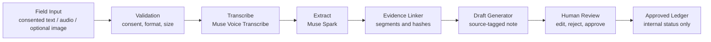

# aLive Bangladesh Coordinator Agent - Evidence-Linked - 1st Proof of meUus - Meta Global AI Developer Hackathon 2026 Startup Track

Bismillah.

## Vision

Anyone can continue from anywhere; the weakest soul ever can continue through meUus. This is a narrow aLive Bangladesh proof for **Build for Your World**: a coordinator turns consented field input into an evidence-linked draft that a human can review.

The project is an MVP, not the complete meUus ecosystem. See [HACKATHON_NEW.md](HACKATHON_NEW.md) for the pre-existing/new-work boundary and [the bridge note](docs/meUus_to_aLive_BRIDGE.md) for the conceptual mapping.

## Hackathon links

- Live app: https://alive-bangladesh-coordinator-meta-a.vercel.app
- Public repository: https://github.com/mdmahadyhasanruju-byte/alive-bangladesh-coordinator-meta-ai
- Demo video: NOT RECORDED / URL PENDING. The live E2E verification is documented in [docs/LIVE_E2E_TEST.md](docs/LIVE_E2E_TEST.md); no video URL is available yet.
- Track: Startup. Problem theme: Build for Your World.

## Workflow



No external message is sent. A correction remains pending review. An approved ledger status is not proof of an external outcome.

## Models and implementation status

- Server-side adapter paths are wired for `muse-voice-transcribe-1.0` transcription and `muse-spark-1.3` structured extraction. The recorded live E2E run used synthetic text fixtures; it did not call these model APIs. Without `META_API_KEY`, the adapters use synthetic fallback responses.
- `muse-wonder-1.0` is configured as a model identifier but not currently wired as a fallback.
- `muse-image-1.0` and `sam-3.1` are listed in adapter configuration but are not called by this implementation.

Meta API credentials are read server-side only. Public demo files are synthetic dialogue and a tiny solid-color placeholder image; no actor audio files are included. See [public/demo/README.md](public/demo/README.md).

## Tech stack

Next.js 16.4.3, TypeScript, pnpm, Tailwind CSS, next-intl message JSON, Meta Model API adapters, and browser-tab `sessionStorage` for the live demo flow. Demo records clear when that tab session ends. This is not durable storage, and reviewer authentication is not implemented.

## Run locally

```powershell
pnpm --ignore-workspace install
pnpm --ignore-workspace run dev
```

Open `/bn`, `/en`, or `/ar`. Build with `pnpm --ignore-workspace run build`; run the synthetic suite with `pnpm --ignore-workspace run test`.

## Evidence and submission preparation

- [Test evidence and metrics](docs/TEST_EVIDENCE.md)
- [Live E2E test record](docs/LIVE_E2E_TEST.md)
- [Three-minute demo script](docs/DEMO_SCRIPT_3MIN.md)
- [Hackathon submission checklist](SUBMISSION_CHECKLIST.md)
- [New work boundary](HACKATHON_NEW.md)
- [Architecture and global direction](02_ARCHITECTURE_GLOBAL.md)

The active production alias returned HTTP 200 for `/bn`, `/en`, `/ar`, `/bn/new`, and `/bn/ledger` on 2026-10-27. The live E2E report covers three synthetic text-only records through human approval. Audio upload, photo analysis, durable storage, and real participant data were not tested. Hackathon details are recorded against the [official event page](https://events.cerebralvalley.ai/e/meta-ai-developer-hackathon). Submission status: NOT SUBMITTED.
