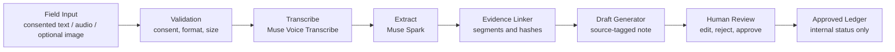

# aLive Bangladesh Coordinator Agent - Evidence-Linked - 1st Proof of meUus - Meta Global AI Developer Hackathon 2026 Startup Track

Bismillah.

## Vision

Anyone can continue from anywhere; the weakest soul ever can continue through meUus. This is a narrow aLive Bangladesh proof for **Build for Your World**: a coordinator turns consented field input into an evidence-linked draft that a human can review.

The project is an MVP, not the complete meUus ecosystem. See [HACKATHON_NEW.md](HACKATHON_NEW.md) for the pre-existing/new-work boundary and [the bridge note](docs/meUus_to_aLive_BRIDGE.md) for the conceptual mapping.

## Workflow



No external message is sent. A correction remains pending review. An approved ledger status is not proof of an external outcome.

## Models and implementation status

- Active API paths: `muse-voice-transcribe-1.0` for transcription and `muse-spark-1.3` for structured extraction and optional image observations.
- `muse-wonder-1.0` is configured as a model identifier but not currently wired as a fallback.
- `muse-image-1.0` and `sam-3.1` are listed in adapter configuration but are not called by this implementation.

Meta API credentials are read server-side only. Public demo files are synthetic dialogue and a tiny solid-color placeholder image; no actor audio files are included. See [public/demo/README.md](public/demo/README.md).

## Tech stack

Next.js 16.4.3, TypeScript, pnpm, Tailwind CSS, next-intl message JSON, Meta Model API adapters, and an in-memory demo store. The demo store resets with its server process and is not a production database. Review API authentication is not implemented.

## Run locally

```powershell
pnpm --ignore-workspace install
pnpm --ignore-workspace run dev
```

Open `/bn`, `/en`, or `/ar`. Build with `pnpm --ignore-workspace run build`; run the synthetic suite with `pnpm --ignore-workspace run test`.

## Evidence and submission preparation

- [Test evidence and metrics](docs/TEST_EVIDENCE.md)
- [Three-minute demo script](docs/DEMO_SCRIPT_3MIN.md)
- [Hackathon submission checklist](SUBMISSION_CHECKLIST.md)
- [New work boundary](HACKATHON_NEW.md)
- [Architecture and global direction](02_ARCHITECTURE_GLOBAL.md)

Hackathon details are recorded against the [official event page](https://events.cerebralvalley.ai/e/meta-ai-developer-hackathon). A public GitHub repository, live deployment, and submitted demo URL are NOT VERIFIED yet.
